# 🏠 K8s Homelab

## 🧾Introduction
This repo contains all the configurations and documentation for my homelab. The purpose of this homelab is to learn more about home servers and setting up kubernetes clusters and to have fun. While this will be practical in many ways, the main goal is education. Some concepts and principles that are kept in mind while designing this is backup strategies, security, scalability and ease of deployment and maintenance.

## 📌 Features
- **Secure Remote Access** via Cloudflare Tunnel, with no open inbound ports
- **Authentication** through Cloudflare Access (Zero Trust), or each app's own login for apps with native clients
- **Glance Dashboard** as centralized management interface
- **Helm-managed deployments**, with the repo as the single source of truth
- **Persistent Storage** on local-path volumes, plus size-capped disk images for data-heavy apps
- **Monitoring** with Prometheus/Grafana, dashboards provisioned as code
- **Alerting** by email through Alertmanager and Grafana (sent via Resend)
- **Logging** with Loki/Alloy, covering pod and kernel logs
- **Automated version checks** with a weekly update report by email

## 🗺️ Architecture

<picture>
  <source media="(prefers-color-scheme: dark)" srcset="docs/architecture-dark.svg">
  
</picture>

## 🛠️ Infrastructure

| Component          | Technology Used       |
|--------------------|-----------------------|
| Hardware           | Dell OptiPlex 7050 Micro (i5-6600T, 32GB RAM, 256GB NVMe SSD) |
| Kubernetes         | K3s single-node cluster (SQLite datastore, Traefik disabled) |
| Deployment         | Helm charts (vendored upstream charts and custom charts) |
| Ingress            | Cloudflare Tunnel (cloudflared in-cluster, no ingress controller) |
| Authentication     | Cloudflare Access |
| Storage            | local-path provisioner + loop-mounted ext4 disk images |
| Dashboard          | Glance |
| Monitoring         | Prometheus + Grafana |
| Alerting           | Alertmanager + Grafana alerts, email via Resend |
| Logging            | Loki + Alloy |

## 🖥️ Applications

### Core Services

| Logo | Name | Description |
|------|------|-------------|
|  | [**Glance**](https://github.com/glanceapp/glance) | Custom dashboard for homelab management |
|  | [**OpenCloud**](https://opencloud.eu) | File sync and sharing |
|  | [**ONLYOFFICE**](https://www.onlyoffice.com/) | Document editor for OpenCloud (WOPI) |
|  | [**Commafeed**](https://commafeed.com) | RSS news feed reader |
|  | [**Planka**](https://planka.app/) | Project tracking and management |
|  | [**Obsidian LiveSync**](https://github.com/vrtmrz/obsidian-livesync) | Note sync across devices, backed by CouchDB |
|  | [**Omni Tools**](https://omnitools.app/) | Self-hosted collection of web utilities and tools |
|  | [**n8n**](https://n8n.io/) | Workflow automation platform |
|  | [**Wallos**](https://github.com/ellite/Wallos) | Subscription tracker and budgeting |
|  | [**BookOrbit**](https://github.com/bookorbit/bookorbit) | Ebook, audiobook and comic library |
|  | [**Portfolio**](https://husamalsheikh.com) | Personal portfolio site (Next.js) |

### Telemetry
| Logo | Name | Description |
|------|------|-------------|
|  | [**Grafana**](https://grafana.com/) | Monitoring and observability dashboard |
|  | [**Prometheus**](https://prometheus.io/) | Metrics collection and alerting |
|  | [**Loki**](https://grafana.com/oss/loki/) | Log aggregation system |
|  | [**Alloy**](https://grafana.com/oss/alloy/) | Collects pod and kernel logs and ships them to Loki |
|  | [**Alertmanager**](https://prometheus.io/docs/alerting/latest/alertmanager/) | Alert routing and email notifications |

### Infrastructure

| Logo | Name | Description |
|------|------|-------------|
|  | [**K3s**](https://k3s.io/) | Lightweight Kubernetes distribution |
|  | [**Helm**](https://helm.sh/) | Package manager for every app deployment |
|  | [**Cloudflare Tunnel**](https://www.cloudflare.com/products/tunnel/) | Secure ingress without public IP |
|  | [**Cloudflare Zero Trust**](https://developers.cloudflare.com/cloudflare-one/) | Secure site authentication |
|  | [**PostgreSQL**](https://www.postgresql.org/) | Database for Planka and BookOrbit (with pgvector) |
|  | [**CouchDB**](https://couchdb.apache.org/) | Document database behind Obsidian LiveSync |

### Planned Services
Services planned for the future

| Logo | Name | Description |
|------|------|-------------|
|  | [**K8up**](https://k8up.io/) | Application-aware backups of PVC and database data |
|  | [**Stalwart**](https://stalw.art/) | Self-hosted mail server |
|  | [**Jellyfin**](https://jellyfin.org/) | Self-hosted media server |

